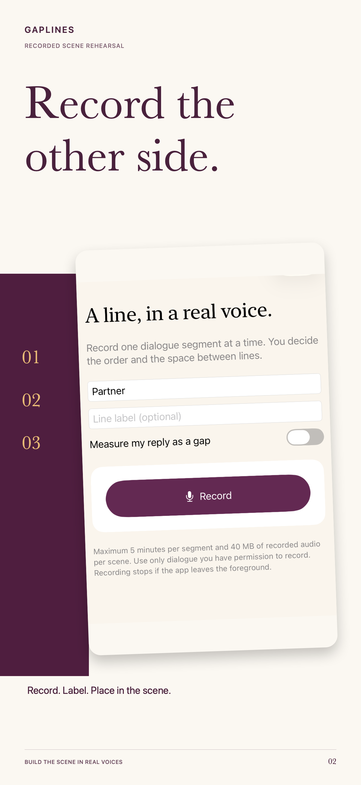
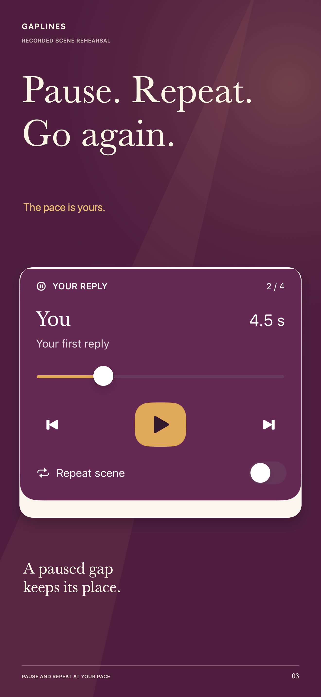
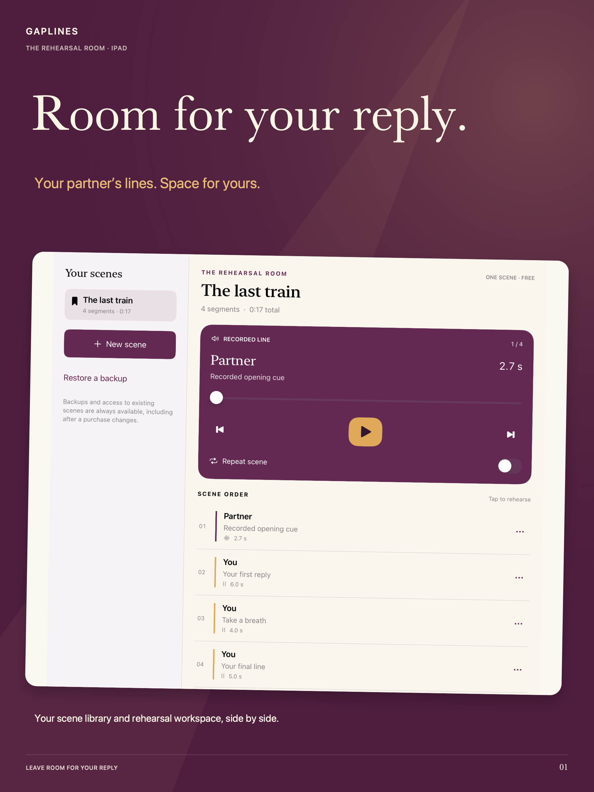

# GapLines: Scene Rehearsal

A native rehearsal room for recorded dialogue and timed reply gaps.

**October18,2026: build1.0(3) validated and uploaded. Release QA is in progress; not yet submitted or released.**

[Product and support](https://sepidehdalir.github.io/gaplines/) · [Privacy](privacy.html) · [iOS portfolio](https://github.com/sepidehdalir/ios-app-portfolio)

  

## The product
Actors preparing a scene need their partner’s cues and space to answer. GapLines keeps these together: record a line, label the speaker, add an editable reply gap, and repeat in scene order. Pause, seek, move between segments or repeat the whole scene. A scene can be exported as playable WAV audio or a portable backup containing its recordings, labels and timing.

One complete scene, single-scene audio export and backup/restore are free. Lifetime Pro adds multiple scenes, saved gap presets and batch audio export through one purchase. No subscription.

## Engineering decisions
- **SwiftUI and AVFoundation:** native recording and playback, a clear scene outline, and a dedicated iPad library/workspace composition. Foreground operation is explicit.
- **Reliable transport:** monotonic gap timing, actual player-clock reconciliation, pause-position preservation and stale callback protection. Audio interruptions stop or pause work intentionally.
- **Durable work:** immutable validated takes and atomic versioned JSON manifests. A failed replacement preserves the previous recording.
- **Portable recovery:** bounded, staged validation of schema, identifiers, paths, timings and decodable media before an atomic restore. Keep-both and replacement are deliberate choices.
- **Real audio export:** streamed PCM WAV rendering follows recorded segments and exact silence durations, including the final gap; cancellation never changes originals.
- **StoreKit2:** signed entitlements, purchase/restore states and preserved access to existing scenes after an entitlement changes.

## Verification and current limits
The final core/local-purchase/native-capture suite passed32 tests. Objective physical-iPhone QA recorded and fully decoded144015 nonzero microphone frames, reopened the saved library, completed playback through the final gap, exported188115 WAV frames and restored a portable backup. This is objective sample/route/completion evidence, not a subjective listening-quality claim. Native workflow checks also cover iPhone, iPad, landscape, small screens, large text and dark appearance.

The signed release targets iPhone and iPad15+ with the current SDK. iOS15 runtime was unavailable locally; target compilation and available-runtime tests are kept distinct. Local StoreKit behavior and genuine remote product lookup were checked. Genuine remote purchase verification was skipped by publisher instruction; no successful remote purchase is claimed. App Store Connect preparation and App Review submission remain pending; no public availability is claimed.

The app has no account, AI voices, transcription, supplied licensed scripts or cloud backend. Recordings remain local unless the user exports or shares them; normal system backup settings apply. Commercial source is private. This public repository contains only reviewed marketing artwork, product context and support/privacy pages.

## Complete campaign
[Five iPhone frames](assets/iphone-01-room-for-your-reply.png) · [Five dedicated iPad frames](assets/ipad-01-room-for-your-reply.png). Browse all ten in the [product showcase](https://sepidehdalir.github.io/gaplines/#campaign). Native UI is authentic; sample labels are fictional and nonpersonal. No user audio or raw physical-device captures are published. US price is shown in the upgrade artwork; prices vary by region.

Created by **Sepideh Javanbakht Dalir** · [arvinify.com](https://www.arvinify.com) · [hello@arvinify.com](mailto:hello@arvinify.com)
